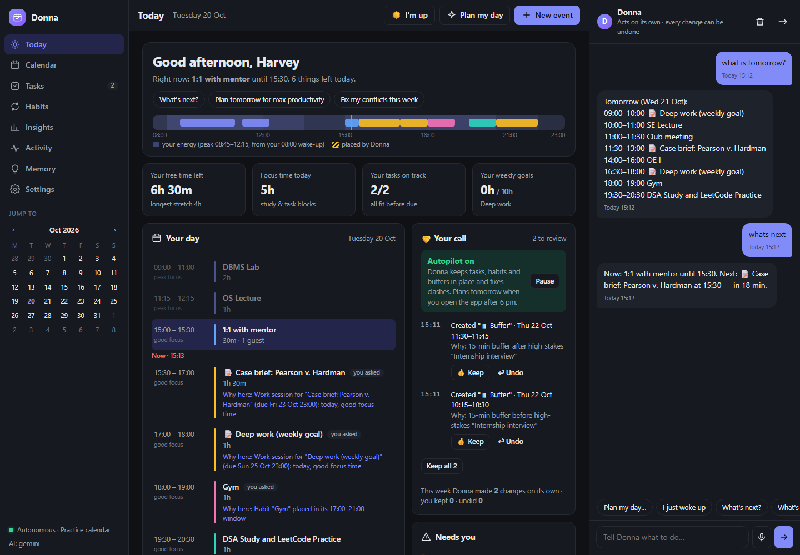
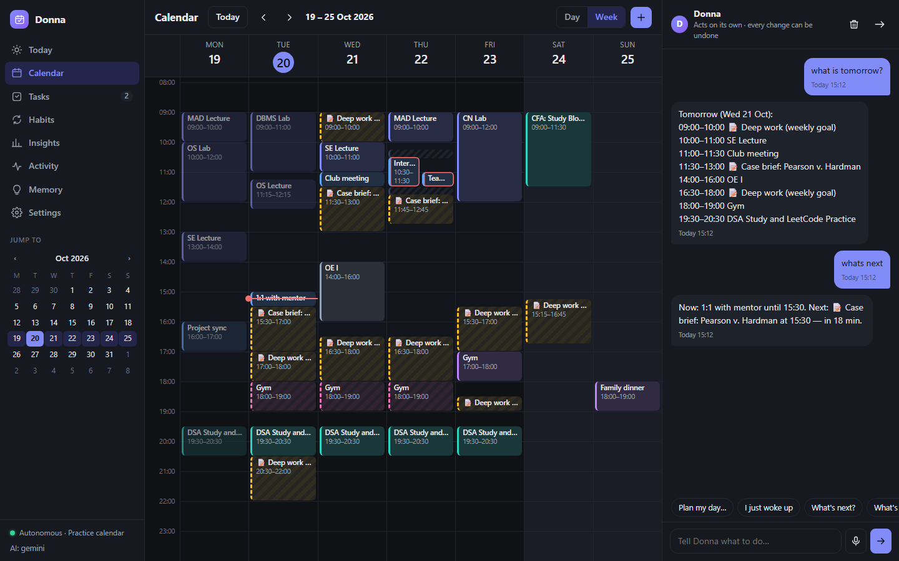
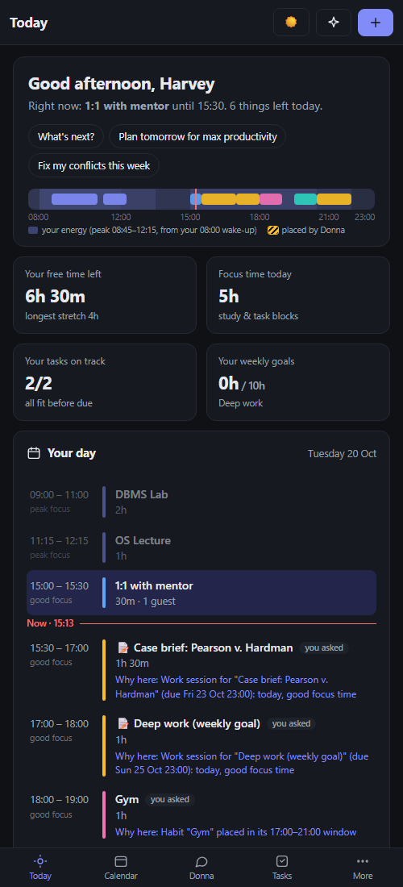

# Donna — an autonomous calendar agent

> *"I'm Donna. I know everything."* — Donna Paulsen, **Suits**

Named after Donna Paulsen, the legendary assistant from *Suits* who always knows what Harvey needs before he
does. **Donna** runs your Google Calendar the same way: tell her what you want in plain words (English or
Hinglish) and she books, moves, clears and plans it — around your classes, your energy and your deadlines —
and shows you exactly what she did and why, so you stay in charge.

Free to run: Cloudflare Workers + D1 + Workers AI, a small Google Apps Script bridge, and a free Gemini key.



| Week view | On your phone |
|---|---|
|  |  |

## What she does
| You say | Donna does |
|---|---|
| "CFA 2h tomorrow" | Picks the **best** slot, not the first one: study goes into your peak-focus hours |
| "Plan my day: CFA 2h, project, 5k run, assignments — max productivity" | Builds the whole day around fixed classes: focus-length blocks, breaks, lunch and dinner, no useless 20-minute scraps |
| "OS assignment due Friday, ~4 hours" | Books study sessions spread over the days before it's due, with a day of slack |
| "Cancel SE and AI lecture, write CFA instead" | Cancels exactly those two (course codes and typos understood) and books CFA in the freed time |
| "I woke up just now" | Re-plans the rest of today from now, keeping classes fixed |
| "Gym 1h sometime between 5 and 9pm on weekdays" | A habit placed in the best free slot each day |
| "DSA every weekday 7:30pm till 30 Nov" | One real repeating Google event |
| "undo that" | Reverts the whole last request |

**Evening autopilot:** open the app after 6 pm and Donna gets tomorrow ready on her own: task sessions,
habits, buffers around exams and interviews, clashes fixed.

## Built so you can trust it
- **Your call:** every change Donna makes on her own shows up on the home screen with the reason, and a
  **Keep** / **Undo** button. Keeping teaches her; undoing reverts just that change. A weekly ledger shows
  how many changes she made and how many you kept.
- **Who placed what:** every block is marked as yours, "you asked", or placed by Donna, with a *Why here* line.
- **Your energy, visible:** a day strip shades your energy curve (from your own wake-up and wind-down
  times), so you can see why deep work lands where it does.
- **Rules in code, not hope:** she never cancels anything you didn't ask to cancel, never double-books,
  never touches protected events (classes, exams, family) unless you name them, and "undo" only runs when you
  actually ask for it. Answers are self-checked (claimed changes vs real changes, times in the report vs times booked).
- **Passkeys:** sign in with Windows Hello, Touch ID or Face ID; "sign out all other devices" in one tap.

## Fast
- The next ~6 weeks of your calendar are kept in the database, so the app opens instantly and never waits
  on Google; it checks Google in the background and redraws only if something changed.
- The app shell and your last view load from the device first (installable PWA).
- A reply never takes more than ~40 s; if the AI is slow she tells you what she managed instead of spinning.

## How it decides where things go
`src/smart.js` scores every possible start time:
- **Energy:** deep work (study, coding, projects) in peak hours, light work (email, review) in the
  post-lunch dip, workouts in the morning or early evening — anchored on *your* wake-up time.
- **No waste:** a placement that leaves a 10–25 minute gap nobody can use loses points.
- **Rhythm:** no two deep blocks glued together; parts of one item spread out; no deep work straight after a long lab.
- **Deadlines:** sessions spread over days, finished a day early when possible, lighter days first.

`plan_day` tries several arrangements and keeps the best whole day. The language model only works out
*what* you want; the code decides *where* it goes.

## Architecture
```
Browser / phone (PWA)  ──►  Cloudflare Worker (worker.js, src/api.js)
                              ├─ D1: settings, tasks, habits, action log, saved calendar copy
                              ├─ AI router (src/llm.js): Gemini → Groq/Cerebras → Workers AI, auto-failover
                              ├─ Engine (src/engine.js): tools + guardrails + undo
                              ├─ Planner (src/planner.js, src/dayplan.js, src/smart.js)
                              └─ Google Apps Script bridge (bridge/Code.gs) ──► Google Calendar
```

## Run it yourself
**On your laptop (practice calendar, no Google needed):**
```
npm test          # 70+ offline tests, no network
npm start         # http://localhost:4321 — Settings → load the demo week, add a free Gemini key
```
(or double-click `Start Donna.bat` on Windows)

**Hosted, with your Google Calendar:**
1. `npx wrangler d1 create donna` → paste the id into `wrangler.toml`.
2. `npx wrangler secret put APP_PASSWORD` (and `SESSION_SECRET`, any long random text).
3. `npm run deploy`, open the URL, sign in.
4. Settings → AI: paste a free [Gemini API key](https://aistudio.google.com/apikey) (Workers AI works without one).
5. Settings → Calendar: set a bridge token, copy the bridge code, paste it into a new
   [Apps Script](https://script.google.com) project, add the *Google Calendar API* service, deploy as a web
   app (access: Anyone), paste the `/exec` URL back and press *Test connection*.
6. Settings → Security: add a passkey for this device.

## Privacy
Your calendar data stays in your own Cloudflare account and your own Google account. Nothing is sent
anywhere else except the text of your requests to the AI provider you choose.
